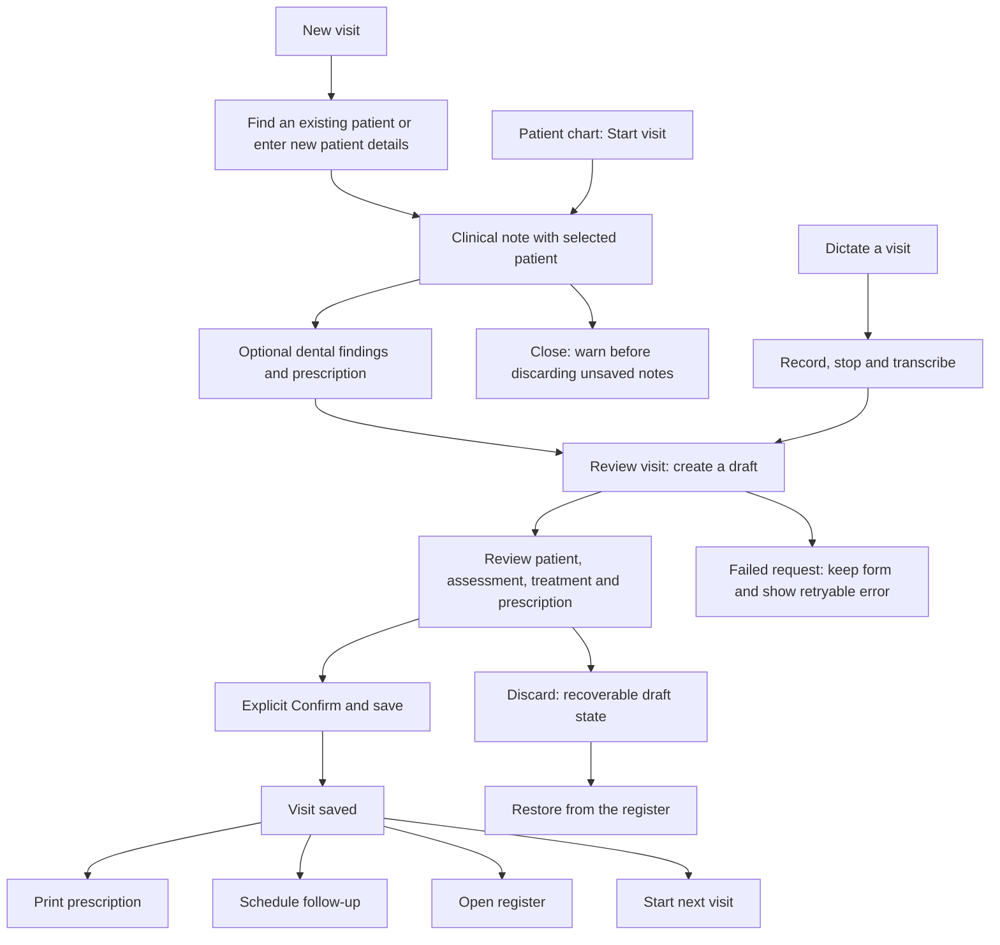

# Product workflow review

The primary workspace should answer three questions: who needs to be seen, which visits still need review, and what the clinician should do next. Navigation and actions now follow that order.

## Daily navigation

| Area | Purpose | Next action |
| --- | --- | --- |
| Today | Today's appointments and confirmed visits; unfinished notes; due follow-ups | Open a patient chart, resume a draft, start a visit, or open the corresponding queue |
| Schedule | Appointments grouped by chair, including unassigned appointments | Confirm, check in, move to consultation, complete, or open the patient's chart |
| Patients | Searchable patient records with consistent demographic and recency columns | Open the chart, then start a visit with that patient selected |
| Register | Search, filter, review, restore and export visits | Review a draft or read a confirmed visit |
| Follow-ups | Due, overdue and completed follow-up tasks | Schedule or complete a follow-up |
| Clinical tools | Treatment plans and search across historical clinical notes | Review an existing plan or open the source patient record |
| Practice management | Billing summary, cashbook, lab/stock monitoring and reports | Open the relevant operational view; record transactions in the cashbook |
| Settings | Profile, practice preferences and access | Save changes before leaving |

Search is available in the sidebar, desktop header and mobile header. Its results include workspaces, patient charts, recent visits and New visit. Browser Back and Forward restore workspaces and the register's URL filters.

## Visit workflow

Selecting a patient in the directory or visit form is an explicit choice; that choice is carried into review. Changing a selected patient’s name clears the chart choice immediately, before the debounced lookup can finish. Voice suggestions still require the clinician to choose the right chart. Neither creating a draft nor reading a chart commits a medical record. The existing confirmation transaction remains the only path into the permanent register.

Manual entry starts with the assessment and treatment plan. Dental charting and medicines expand when needed. Review presents the clinical assessment before the dental chart. Patient details remain visible, and Back preserves the note while changing the patient step.

## Recovery and honest states

- Today uses its own server-loaded daily entries, rather than reusing a filtered register page. Historical search results cannot become today's activity.
- The unfinished queue includes the past 12 months and opens the exact draft, including drafts that have no patient ID. Its range survives reload.
- Appointment, draft and follow-up summaries have independent loading and failure states. A failed request is not presented as zero work.
- Appointment day boundaries use Asia/Kolkata, even when the device is in another timezone. Slower responses cannot overwrite a newer selected date.
- Unassigned appointments remain visible when the practice also has named chairs.
- Failed appointment updates leave the appointment in its previous state and show the server's error.
- An unfinished manual form warns before closing or reloading. A failed draft request retains all typed fields on screen. These fields are not stored on the device.
- A failed draft deletion leaves review open and shows an error.
- Billing totals show an unavailable state while loading or after failure, instead of displaying misleading zero balances.

## Remaining product gaps

These are existing capabilities that still need complete workflows, rather than visual changes. They should not be described as finished practice-management features.

1. **Appointment → encounter association.** Opening a chart from the schedule and starting a visit now works, but the encounter does not retain an appointment ID. Completing an appointment is still an explicit, separate action. Add a transactional association before offering automatic completion or appointment-based billing.
2. **Billing transactions.** The billing workspace summarizes invoices and balances; it does not provide a complete estimate → invoice → payment → refund editing flow. The cashbook is the current place to enter income and expenses. Add patient-scoped invoice editing, allocation and reversals before calling billing complete.
3. **Lab and inventory operations.** These screens monitor existing records. Ordering lab work, tracking delivery/fitting, receiving stock, and recording stock consumption need mutation flows and role-specific validation.
4. **Draft identity recovery.** Clinical edits autosave, but changed phone/sex fields and the selected patient choice do not all round-trip through the draft-update API. A full Save draft and close action should persist that identity state transactionally before being introduced. Recovered drafts require the clinician to check the patient again.
5. **Long directory browsing.** Search and last-visit filters work, and the count distinguishes the returned page from the full result. Pagination is still needed to browse a large clinic without entering a search.

## Verification

The regression suite covers patient selection through the confirmation request, unlinked draft recovery, date-filter persistence, browser navigation, failed manual saves, unassigned appointments, appointment errors and independent Today request failures. Existing voice tests exercise a real synthetic microphone and intercept the irreversible register write. Workspace checks cover all twelve destinations and their server-rendered navigation state; phone checks cover overflow and minimum touch targets.

All workflow test writes are intercepted. The tests do not create fictional permanent clinical records.
